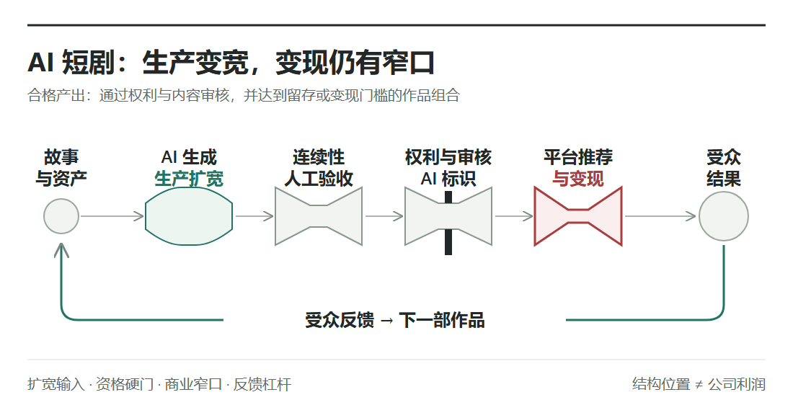
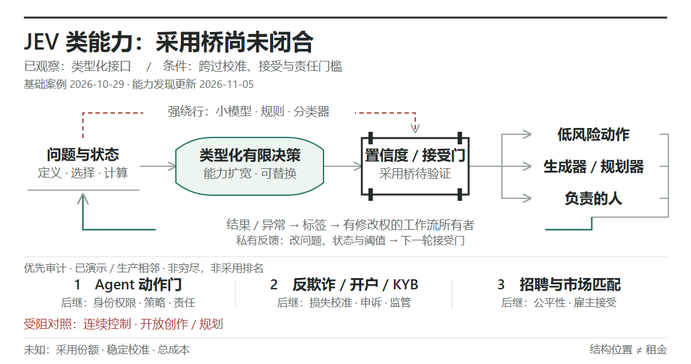

# Industry Bottleneck Audit

一个用于分析产业窄口、议价权和技术冲击的公开试用 Skill。

它不把“重要、困难、集中、涨价”直接等同于窄口，而是先问：**什么合格产出必须穿过哪些节点，哪些替代路径真正可用，谁拥有验收、修改和反馈权？**

## 它能回答什么

- 一个行业的利润和议价权被哪些节点约束？
- 新技术降低某环节成本后，窄口消失、迁移，还是形成新的聚类？
- 高集中节点究竟是硬门、杠杆点、周期性紧张，还是并不构成窄口？
- 某家公司位于关键节点，是否真的能捕获系统价值？
- 半年后出现新证据，哪些旧假说需要更新？

它不提供自动投资建议，也不保证从弱公开信息推导出完整市场结构。

## 效果预览

[](https://htmlpreview.github.io/?https://github.com/zzhangio/industry-bottleneck-audit/blob/main/demo/ai-short-drama-topology-demo-v2.html)

**[在线打开完整交互图](https://htmlpreview.github.io/?https://github.com/zzhangio/industry-bottleneck-audit/blob/main/demo/ai-short-drama-topology-demo-v2.html)** ｜ [查看案例](cases/ai-short-drama/README.md) ｜ [查看来源账本](cases/ai-short-drama/sources.md)

README 只展示一条可扫描的当前判断链；完整图可以切换过去、当下和条件未来，点击节点查看接受权、替代路径、证据限度与证伪条件。在线入口由 `htmlpreview.github.io` 渲染仓库中的同一份静态 HTML；也可以 clone 后直接离线打开源文件。

V2 交互图和 README 摘要构图由 `gpt-6-astra` medium 实质编写，主代理负责冻结事实边界、核对来源、渲染验收和发布。它们是有截止日期的判断演示，不是实时行业数据。更早的开发基线与内部审核路径只保留在私有研究仓库，不随公开包分发。

### JEV 类能力：采用桥尚未闭合

[](https://htmlpreview.github.io/?https://github.com/zzhangio/industry-bottleneck-audit/blob/main/demo/jev-technology-shock-demo.html)

**[在线打开 JEV 交互解释](https://htmlpreview.github.io/?https://github.com/zzhangio/industry-bottleneck-audit/blob/main/demo/jev-technology-shock-demo.html)** ｜ [查看案例](cases/jev-technology-shock/README.md) ｜ [查看来源账本](cases/jev-technology-shock/sources.md)

这个例子故意不把新接口画成已经形成的产业窄口。完整版能力发现层把 **Agent 行动前政策门、实时反欺诈/开户/KYB、招聘与市场匹配**列为优先审计候选，同时标出 SOC/SRE、内容平台、游戏仿真和机器支付等邻接面；这些是审计优先级，不是采用率或赢家排名。默认视图只确认能力类和相邻实现已经出现；页面可以切换到“采用桥闭合”和“类别被通用模型、规则或云平台吸收”两种条件状态。结构位置不等于单一供应商已经获得利润或持久租金。

## 五分钟试用

Windows PowerShell：

```powershell
git clone https://github.com/zzhangio/industry-bottleneck-audit.git
cd industry-bottleneck-audit
.\skill\industry-bottleneck-audit\scripts\install_skill.ps1
```

macOS 或 Linux：

```bash
git clone https://github.com/zzhangio/industry-bottleneck-audit.git
mkdir -p ~/.codex/skills/industry-bottleneck-audit
cp -R industry-bottleneck-audit/skill/industry-bottleneck-audit/. \
  ~/.codex/skills/industry-bottleneck-audit/
```

重新打开一个 Codex 会话，然后直接提问：

```text
使用 $industry-bottleneck-audit 快速分析这个行业：合格产出是什么，
当前最可能的窄口在哪里，谁有议价权，什么事实会推翻判断？
```

若明确要求“完整、深入、可审计”，Skill 会进入完整版。用户不需要选择内部方法模块。

## 两个示例，两种入口

### 1. 已有行业发生结构变化

[AI 短剧](cases/ai-short-drama/README.md)从成熟的短剧生产与分发链出发，比较 AI 生成成本下降前后：普通制作被扩宽，但平台分发、商业验证、合规与反馈回流相对收紧。

示例问题：

```text
使用 $industry-bottleneck-audit 快速分析 AI 短剧：
生成成本下降后，利润和议价权迁移到哪里？
```

### 2. 新技术可能冲击多个行业

[JEV 类有限答案语义决策模型](cases/jev-technology-shock/README.md)从能力事件出发，不先指定赢家，而是寻找它与现有任务的功能重叠、采用桥、后继约束和可观察预测。

[交互解释](https://htmlpreview.github.io/?https://github.com/zzhangio/industry-bottleneck-audit/blob/main/demo/jev-technology-shock-demo.html)把当前能力、条件扩散和被吸收/绕过三种状态分开，并显示置信度接受门、异常处理、工作流所有者的私有反馈回路，以及跨行业候选、证据上限和后继约束。

示例问题：

```text
使用 $industry-bottleneck-audit 快速分析 JEV 类有限答案决策模型：
它松动了哪些旧节点，新的约束会迁到哪里？
```

两个示例故意不采用同一个结论模板：前者有较短、外部可见的行业反馈环；后者大量反馈仍在产品或组织内部，因此产业迁移只能保持条件性。

## 结果应该包含

快速版至少应让人一眼看到：

1. 合格产出与案例边界；
2. 一条主因果链和最强替代路径；
3. 当前窄口、可能的后继约束；
4. 系统依赖与企业捕获的分离；
5. 已知、推断、未知；
6. 最强反例、证伪条件和复查触发器。

完整版可额外生成结构化 audit bundle，并用内置 validator 检查字段和交叉引用。验证通过只代表机器契约成立，不代表事实或因果已经正确。

## 不依赖特定搜索服务

Skill 不携带搜索 API 或密钥。它可以使用当前环境允许的搜索工具，也可以读取用户提供的来源包。若没有可追溯证据，应返回 `tool_blocked` 或证据不足，而不是补写一个看似完整的行业结论。

## 参与试用

请带一个你真实关心、但没有出现在示例里的问题。完成后使用 [试用反馈模板](feedback/TRIAL-PROTOCOL.md)，尤其欢迎：

- 没有找到稳定窄口的负例；
- 结论看起来合理但遗漏关键节点的失败案例；
- 局部技术进步没有传到行业层的案例；
- 发现了新的用途，而不仅是修改措辞。

完整贡献说明见 [CONTRIBUTING.md](CONTRIBUTING.md)。当前版本是公开 beta，不构成投资、法律或职业建议。

## 许可

- Skill、schema 与脚本：MIT，见 [LICENSE](LICENSE)。
- 原创文档和案例：CC BY 4.0，见 [LICENSE-DOCS.md](LICENSE-DOCS.md)。
- 外部资料仍归原权利人所有；本仓库只保留链接、来源说明和原创摘要。

