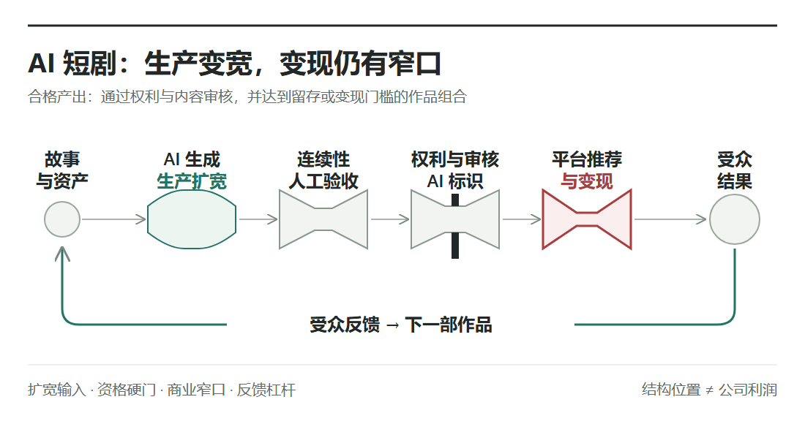
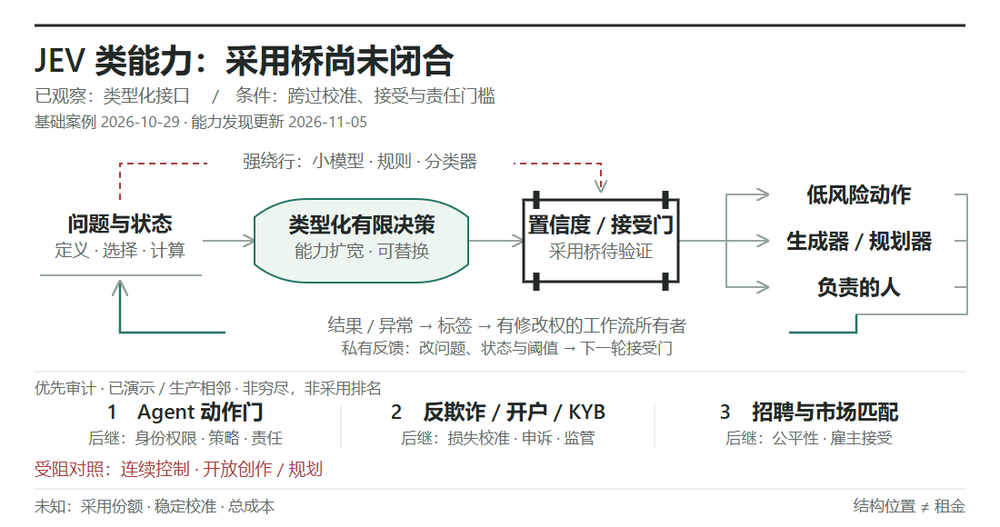

# Demo previews

## AI short drama

- [Open the Astra-authored v2 interactive topology](https://htmlpreview.github.io/?https://github.com/zzhangio/industry-bottleneck-audit/blob/main/demo/ai-short-drama-topology-demo-v2.html)
- [View the v2 self-contained HTML](ai-short-drama-topology-demo-v2.html)
- [Read the v2 visual contract](astra-v2-brief.md)
- [Read the v2 authorship and review record](ai-short-drama-v2-visual-review.md)

The v2 HTML and README composition were materially authored by a fresh `gpt-6-astra` agent at medium reasoning from a frozen analytical brief. The primary agent retained control of facts, evidence boundaries, screenshots, validation, and promotion.

The page reuses a dated case reconstruction. Past, present, and conditional future states are analytical views, not live market data or investment predictions. Earlier development baselines and internal review paths remain in the private research archive and are intentionally absent from this public package.

## JEV-like bounded semantic decisions

- [Open the Astra-authored interactive explanation](https://htmlpreview.github.io/?https://github.com/zzhangio/industry-bottleneck-audit/blob/main/demo/jev-technology-shock-demo.html)
- [View the self-contained HTML](jev-technology-shock-demo.html)
- [View the README-card source](jev-readme-card.html)
- [Read the frozen visual brief](jev-astra-brief.md)
- [Read the authorship and review record](jev-visual-review.md)

The JEV visual is deliberately not a second mature-industry cone. Its default state shows capability evidence and an unresolved adoption bridge; the two conditional states show either constraint migration into definition, state, calibration, acceptance and exception rights, or absorption by general models, rules, classifiers or cloud control planes. An always-visible discovery surface ranks agent pre-action policy gates, fraud/onboarding/KYB, and recruitment/marketplace matching for separate audits, then records adjacent frontiers, evidence ceilings, successor constraints, hypotheses, and blocked controls. The public source ledger is preserved inside the interactive page.
