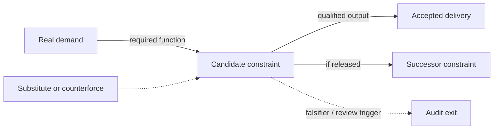

# Visual Preview Module

Use this module when the user asks to preview, compare, present, or visually audit a result. The visual is a view over the same claims and evidence as the written analysis; it must not introduce a second conclusion store.

Apply [human-review-compression.md](human-review-compression.md) before laying out a human-facing visual. The full graph may remain available interactively, but the first view must use the compressed decision path rather than rendering every machine-readable node at equal weight.

## Routing

- **Quick Scan:** include one compact control picture in the Markdown result. Prefer Mermaid when the preview surface supports it. Show the main functional journey, one bypass or counterforce, the likely successor constraint, and one audit exit. Do not create a canonical bundle solely to draw a quick result.
- **Full Audit or versioned case:** validate the canonical audit bundle, then render the standalone interactive HTML with `scripts/render_audit_visual.py`.
- **Evidence-event update:** preserve the prior snapshot and show the new fact, changed edge or node, unchanged constraints, expected next change, and verification trigger. Do not redraw a forecast as an observed topology change.
- **Technology-first discovery:** show the demonstrated capability shock separately from candidate industries. Draw a before/after path only for a frozen candidate case.

Generate an HTML artifact when the user explicitly asks for a visual, when the report will be revisited over time, or when clicking through evidence materially improves auditability. Do not generate one automatically for a small chat-only answer.

## Required Astra Visual Pass

Every standalone HTML visual must be generated or materially authored by a fresh `gpt-6-astra` subagent with `medium` reasoning. Astra participation only as a late reviewer is insufficient. Treat Astra as the HTML visual author and usability specialist, not the owner of facts or analytical conclusions.

Use the collaboration in these stages:

1. The primary agent freezes the validated bundle, focal hierarchy, editorial compression, and non-negotiable claim/evidence boundaries.
2. A fresh Astra agent at `medium` generates the HTML draft or performs the material visual rewrite. Give it the validated data and visual contract, not permission to invent facts.
3. The primary agent checks the generated HTML against the bundle, repairs factual/ID/accessibility defects, and records any analytical change it rejected.
4. Astra performs the final visual/usability pass after material corrections when practical. The primary agent then runs browser, interaction, mobile, and overflow checks.

Astra may recommend layout, styling, labels that preserve meaning, and interaction changes. It may not silently alter `Y/Q/Omega`, claim text, epistemic status, node/edge IDs, evidence links, minimum-cut membership, company mapping, falsifiers, or observed-versus-forecast status. The primary agent owns those fields.

Keep a short `visual-review.md` beside a reusable or published HTML artifact containing:

```text
requested reviewer: gpt-6-astra
reasoning effort: medium
generation role: initial HTML / material rewrite / final visual pass
review date
artifact reviewed
must-fix findings
accepted changes
rejected changes and reason
remaining visual limitations
```

Do not silently substitute another model. If `gpt-6-astra` at `medium` is unavailable, do not generate or materially revise a standalone HTML visual as a final artifact. A non-Astra scaffold may exist only as `draft_astra_generation_pending`; disclose that the required generation gate has not passed.

## Focal Hierarchy Before Layout

Choose the focal output before arranging levels. Do not mix supply-chain distance, technical abstraction, company ownership, and acceptance authority on one flat plane.

### Semiconductor-to-AI upstream view

When the visual question concerns semiconductors, compute infrastructure, memory, packaging, networking, power, or their effect on frontier AI, use the AI model or qualified model capability as the declared **focal total waist** for this project view:

```text
far upstream / slow physical base
materials, energy, equipment and process-enabling capability
-> wafer process, design enablement and fabrication
-> die, memory, package, network and system integration
-> compute cluster / cloud execution
-> AI model training, inference or accepted capability  [focal total waist]
-> product deployment, task acceptance and user/environment feedback
```

- Arrange upstream layers by functional distance from the AI-model waist: the farther the required transformation or qualification chain, the higher the layer.
- Treat “AI model as total waist” as the declared analytical lens, not proof that one model vendor is a monopoly or that every semiconductor node currently binds.
- Show a semiconductor node as an active or latent sub-waist only when its qualified output and bridge into model capability are explicit.
- Do not place optional downstream applications, upstream materials, EDA checks, and model capability at the same hierarchy merely because all are important.
- Preserve zoom-in: each upstream sub-waist may have its own local loop, while the parent loop closes only when model capability or accepted deployment responds.

### Product-delivery and non-AI-parent views

For downstream applications such as AI short drama, or for industries whose qualified output is not an AI model, retain the product-delivery topology:

```text
real demand -> production/decision workflow -> acceptance/distribution
-> realized outcome -> feedback to the next product cycle
```

Do not force semiconductor-style vertical distance onto these cases. Place nodes by their role in delivering and accepting the frozen `Y`.

### Cross-company or cross-industry loops

Draw a cross-boundary loop only when the loop is auditable. Its visible label or drill-down must identify:

```text
evidence producer
-> transmitted evidence/state
-> actor with modification right
-> final acceptor
-> returned result or failure signal
-> bridge condition and natural lag
```

A return arrow without these fields is decoration, not a validated loop. Distinguish local private loops from parent-industry loops and mark the cross-company interface where local learning becomes accepted output.

## Primary View

The first viewport should answer:

```text
What qualified output is being produced?
-> what currently narrows or accepts it?
-> what bypass exists?
-> where does the constraint move if released?
-> what would falsify the picture?
```

Default emphasis:

- highlight the current minimum cut;
- distinguish observed, inferred, conditional, and speculative edges without relying on color alone;
- label arrows with the transmitted object;
- show company names only where the bundle supports a company-node mapping;
- keep scores and technical notation in drill-down details;
- keep the largest unknown and evidence cutoff visible.

Clicking a node should reveal its plain function, owner, qualification, Gate role, optional Leverage role, release condition, substitutes, evidence, unknowns, and company mappings. Claims expose their evidence, falsifier, and review trigger. Sources remain directly reachable.

## Quick Mermaid Pattern

Adapt labels to the actual case and keep the graph small:



Mermaid is a communication view, not evidence. Attach claim IDs or a short evidence table immediately below it when the result is meant to be audited.

## Full HTML Renderer

Run from the skill directory or provide absolute paths:

```powershell
python scripts/validate_audit_bundle.py examples/minimal-audit-bundle.json
python scripts/render_audit_visual.py examples/minimal-audit-bundle.json output/audit-preview.html
```

The renderer is dependency-free and embeds the input bundle into one local HTML file. It provides:

- interactive functional topology;
- plain/technical detail toggle;
- minimum-cut and alternative-path emphasis;
- claims, timeline/predictions, company mapping, and source tabs;
- node-level evidence, unknowns, falsifiers, and review triggers;
- responsive desktop and mobile layouts.

The renderer does not validate facts or repair an invalid bundle. Validate the JSON first. If the graph contains many nodes, preserve the full interactive artifact but also publish one smaller editorial view that contains only the decision-changing path.

## Snapshot Compatibility

Keep stable `node_id`, `edge_id`, and `claim_id` values across reruns. A later visual may add or retire nodes, but comparison mode must not silently reuse an old ID for a different function. If `Y/Q/Omega` changes materially, create a new case rather than presenting it as an ordinary snapshot update.

## Acceptance Check

- The first viewport identifies the output, minimum cut, largest unknown, and evidence cutoff.
- Every visible factual node or edge traces to IDs in the bundle.
- Conditional and speculative paths are visibly labeled.
- The visual states what remains unknown and what would change the judgment.
- Company capture is not implied by node importance alone.
- Mobile text does not overlap, and the topology remains usable without hover.
- The adjacent visual review records `gpt-6-astra` with `medium` reasoning, the review disposition, and any remaining limitation.
